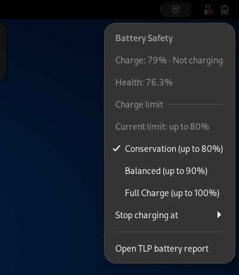

<p align="center">
  
</p>

<h1 align="center">Battery Safety</h1>

<p align="center">
  Charge limits for your laptop battery, one click from the GNOME top bar.<br>
  Powered by <a href="https://linrunner.de/tlp/">TLP</a>.
</p>

<p align="center">
  
  
  <a href="https://github.com/Prarambha369/battery-safety/releases/latest"></a>
</p>

<p align="center">
  
</p>

---

Keeping a lithium-ion battery between roughly 20% and 80% instead of at 100% slows its wear considerably, which matters most for laptops that stay plugged in. Battery Safety puts that control in your top bar.

## Features

- **One-click presets**: *Conservation* (40–80%), *Balanced* (20–90%) and *Full Charge* (0–100%). The active preset shows a check mark.
- **Custom limits**: choose any start and stop threshold your hardware supports.
- **Honest status**: shows the thresholds your firmware is actually using, read directly from the kernel. It doesn't assume the last button you pressed took effect.
- **Battery health at a glance**: charge, health (current vs. design capacity), and, where your battery reports them, temperature and cycle count.
- **Survives reboots**: limits are saved to a TLP drop-in file, so they stay in place after a restart.
- **One password prompt per change**, with no background daemons and no polling of external commands.
- **Works with stop-only hardware**: if your laptop only supports a stop threshold, the start-threshold controls are hidden automatically.
- The tray icon shows whether a limit is active: a partly filled battery when protected, an empty outline when charging to 100%.

## Requirements

| | |
|---|---|
| GNOME Shell | 45, 46, 47, 48, 49, 50, 51 |
| [TLP](https://linrunner.de/tlp/) | 1.4 or newer (uses `tlp setcharge`) |
| Hardware | A laptop whose kernel driver exposes charge thresholds: many ThinkPad, ASUS, Dell, Huawei, Lenovo, Framework and System76 models, among others. See [TLP's battery care list](https://linrunner.de/tlp/settings/bc-vendors.html). |
| polkit | For the password prompt (`pkexec`). Installed by default on GNOME. |

Check whether your laptop supports thresholds:

```sh
ls /sys/class/power_supply/BAT*/charge_control_*_threshold
```

## Installation

### From extensions.gnome.org

<a href="https://extensions.gnome.org/extension/11908/battery-safety/"></a>

Install it from [extensions.gnome.org/extension/11908/battery-safety](https://extensions.gnome.org/extension/11908/battery-safety/) with the browser integration, or with the *Extension Manager* app. Version 2.1 is waiting for review, and the install button will work once it's approved.

### From a release

1. Download `battery-safety@misterbashyal.shell-extension.zip` from the [latest release](https://github.com/Prarambha369/battery-safety/releases/latest).
2. Install and enable it:
   ```sh
   gnome-extensions install --force battery-safety@misterbashyal.shell-extension.zip
   ```
3. Log out and back in (Wayland), then enable **Battery Safety** in the *Extensions* app or run:
   ```sh
   gnome-extensions enable battery-safety@misterbashyal
   ```

### From source

```sh
git clone https://github.com/Prarambha369/battery-safety.git
cd battery-safety
./scripts/pack.sh
gnome-extensions install --force dist/battery-safety@misterbashyal.shell-extension.zip
```

## How it works

| Action | What happens |
|---|---|
| Reading status | Reads `/sys/class/power_supply/BAT*/`. No root access and no subprocesses. |
| Changing a limit | Runs **one** `pkexec` command that writes `/etc/tlp.d/99-battery-safety.conf` and calls `tlp setcharge START STOP BAT`, so the change applies immediately and persists. |
| Undoing it | Choose *Full Charge* in the menu, then optionally delete `/etc/tlp.d/99-battery-safety.conf`. If you have your own thresholds configured in TLP, delete the file and run `sudo tlp setcharge` (no arguments) to apply them. With no other thresholds configured, there is nothing for TLP to restore and many laptops keep the last limit even across reboots, so choose *Full Charge* first, or run `sudo tlp fullcharge` while on AC power. |

> [!NOTE]
> TLP reads `/etc/tlp.conf` **after** the drop-in directory. If you have uncommented `START_CHARGE_THRESH_*` / `STOP_CHARGE_THRESH_*` lines there, they win at the next boot. Battery Safety detects this and tells you the change is only active until reboot.

## Settings

```sh
# How often the menu refreshes, in seconds (default 30; it also refreshes whenever you open it)
gsettings --schemadir ~/.local/share/gnome-shell/extensions/battery-safety@misterbashyal/schemas \
  set org.gnome.shell.extensions.battery-safety refresh-interval 60
```

## Development

```sh
npm test                       # unit tests for parsing and validation (node ≥ 20)
./scripts/smoke-test.sh 45     # load the extension in headless GNOME Shell in Docker
./scripts/pack.sh              # build dist/*.shell-extension.zip
```

Watch logs on a real session with `journalctl -f -o cat /usr/bin/gnome-shell`.

## Support

If Battery Safety saves your battery, consider [sponsoring the project](https://github.com/sponsors/Prarambha369). Bug reports and pull requests are welcome.

## License

[GPL-2.0-or-later](LICENSE) © Prarambha369 ([misterbashyal](https://github.com/Prarambha369))
